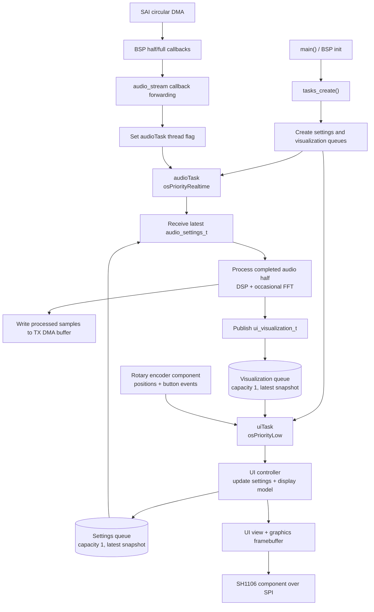

# RealTime-Audio-DSP: Real-Time Audio Processor on STM32L476RG

A real-time audio DSP firmware project for the **STM32L476RG** (Arm Cortex-M4 with FPU), using **FreeRTOS**, **STM32 HAL**, and **CMSIS-DSP**. It contains nine selectable audio effects, an OLED user interface, a 16-band spectrum display, and a signal-level meter.

The firmware builds for the STM32L476RG. Final validation of the connected microphone, DAC, OLED, and encoder hardware is still required; see [Hardware Configuration and Validation](#hardware-configuration-and-validation).

---

## Operating Principle and User Interface

The intended setup captures digital audio through SAI, processes it on the MCU, and transmits stereo samples through SAI to an external DAC. The firmware configures 32-bit SAI data slots and stores samples in 32-bit words. Confirm the sample alignment, connected module compatibility, and physical wiring on the target board.

The user controls the system via two rotary encoders with integrated pushbuttons (KY-040), with real-time graphical feedback presented on an OLED display (SH1106):

*   **Encoder 1 (Left Knob - Effect Selection)**:
    *   *Rotation*: Switches between the 9 available DSP algorithms in real time (Clean/Bypass, Robot, Distortion, Delay, Pitch Shifter, Tremolo, IIR Filter, Bitcrusher, Noise Gate).
    *   *Pushbutton*: Selects Clean when another effect is active; when Clean is already selected, toggles master mute.
*   **Encoder 2 (Right Knob - Parameter Adjustment)**:
    *   *Rotation*: Modulates the primary parameter of the currently active effect in real time (e.g., modulation frequency in Robot mode, delay time in Echo mode, saturation gain in Distortion mode, or filter cutoff frequency).
    *   *Pushbutton*: Resets the active parameter to its default value or toggles effect sub-modes (e.g., LFO sine/square wave shape, Soft/Hard-clipping distortion curves, Low-Pass/High-Pass filter topologies).
*   **OLED Display 128x64 px (Real-Time Visualizer)**:
    *   *Top Status Bar*: Displays the active effect name (e.g., `EFEKT: ROBOT`), parameter label, precise numerical value with units (e.g., `250Hz`, `150ms`, `4x`), and a graphical progress bar.
    *   *Main Screen Area*: Renders an animated 16-band FFT frequency spectrum analyzer grouped into Bass, Mid, and Treble ranges, complete with dynamic automatic gain control (AGC) and falling peak hold indicators.
    *   *Right Edge*: Displays a vertical signal-level meter with a high-level marker.

---

## Key Features

*   **9 Real-Time DSP Audio Effects**:
    1.  *Clean / Bypass*: Selects the unmodulated signal path with master gain control.
    2.  *Robot*: Amplitude modulation (Ring Modulator) with selectable sine/square LFO generator.
    3.  *Distortion*: Multi-segment piecewise-linear analog-style saturation (Soft-Clipping and Hard-Clipping modes).
    4.  *Echo (Delay)*: Digital feedback delay line (up to 600 ms) with adjustable delay time and feedback decay.
    5.  *Pitch Shifter*: Dual-tap circular delay line with triangular crossfading and variable pitch transposition rate.
    6.  *Tremolo / Auto-Pan*: Volume and stereo pan modulation based on a precomputed sine look-up table (LUT).
    7.  *IIR Filter*: Two cascaded biquad stages with selectable Low-Pass and High-Pass response.
    8.  *Bitcrusher*: Sample rate downsampling and bit-depth decimation (retro 8-bit / 4-bit sound).
    9.  *Adjustable Noise Gate*: Linear envelope tracker with rapid attack and slow release.
*   **16-Band Spectrum Analyzer (FFT)**: Local, custom implementation of a 256-point complex Radix-2 DIT Fast Fourier Transform with logarithmic frequency bin grouping.
*   **Dynamic UI Graphics**: Real-time spectrum scaling, falling peak-hold markers, and a signal-level meter with a high-level marker.

---

## Hardware Configuration and Validation

The table below reflects the **pin configuration in the firmware**, not a verified wiring diagram. Confirm the board revision, module pinout, voltage levels, and signal connections before powering the hardware. In particular, do not assume that README examples for microphone/DAC modules establish that those exact modules have been tested with this firmware.

| Firmware signal | Peripheral / pin configured in code | Notes |
| :--- | :--- | :--- |
| SAI transmit data | SAI1 Block A, `PC3` | Audio output data; connect to a compatible DAC input after confirming its clocking requirements. |
| SAI clocks / frame sync | SAI1 Block A, `PB10` (SCK), `PB9` (FS) | Block A is configured as master transmitter. |
| SAI receive data | SAI1 Block B, `PB5` | Synchronous receiver; shares timing with Block A. |
| OLED SPI | SPI1 `PA5` (SCK), `PA7` (MOSI); `PB12` (CS), `PC8` (DC), `PC6` (RESET) | SH1106 driver uses the BSP SPI and GPIO interfaces. |
| Encoder 1 | TIM2 `PA0`/`PA1`; button `PB14` | Quadrature timer plus a GPIO button input. |
| Encoder 2 | TIM3 `PA6`/`PC7`; button `PB13` | Quadrature timer plus a GPIO button input. |

The firmware build succeeding verifies compilation and linking only. Verify SAI clocks/data, actual module wiring, OLED communication, encoder direction/button response, and sustained audio playback on the physical board.

---

## Architecture and Data Flow

The firmware separates board-specific hardware access, reusable components, application behavior, and RTOS scheduling:

| Layer | Responsibility |
| :--- | :--- |
| `Bsp/` | STM32 board setup and HAL-facing GPIO, SPI, timer, SAI, and DMA operations. |
| `Components/` | SH1106 and rotary-encoder drivers; use BSP interfaces instead of configuring MCU peripherals directly. |
| `Core/Audio/` | Owns RX/TX DMA buffers and exposes the audio stream. It forwards DMA half/full completion through callbacks; it does not wait on or signal RTOS tasks. |
| `App/` | Audio settings and UI models, DSP effects, FFT, UI controller/view, graphics, and widgets. |
| `Tasks/` | Creates the RTOS tasks and queues; task entry points coordinate application logic, hardware interfaces, and message exchange. |

### Task roles and priorities

`tasks_create()` initializes the inter-task queues before creating either task.

| Task | CMSIS-RTOS priority | Work |
| :--- | :--- | :--- |
| `audioTask` | `osPriorityRealtime` | Starts the audio stream, waits for DMA completion thread flags, applies the newest settings at a block boundary, processes samples, and publishes visualization data. |
| `uiTask` | `osPriorityLow` | Runs a 50 ms loop: samples encoder/button inputs, updates the UI controller, exchanges snapshots, renders the screen, and flushes it to the OLED. |

The audio task has the higher priority because each completed half-buffer must be processed before DMA reuses that memory. At the configured 32,170 Hz sample rate, a half-buffer contains 128 stereo frames and represents about 4 ms of audio. The UI task is lower priority so display work yields to audio processing.

### Inter-task messages

`task_messages` owns two CMSIS-RTOS message queues, each with capacity one:

* **UI → audio:** `audio_settings_t`. The queue keeps the latest complete settings snapshot; an older pending snapshot may be replaced.
* **Audio → UI:** `ui_visualization_t`. It contains the peak level and spectrum magnitudes for display; older pending visualization data may be replaced.

The queues copy message data, so neither task accesses the other task's mutable settings or visualization state directly. The UI retains the last visualization it received when the queue is empty.

### Audio processing sequence

1. SAI circular DMA fills the RX buffer while transmitting the TX buffer.
2. The BSP's DMA callbacks are forwarded by `audio_stream` to callbacks registered by `audioTask`.
3. Those callbacks set the corresponding audio-task thread flag; the task wakes and identifies which buffer half completed.
4. The task receives the newest settings snapshot, processes the completed half through the DC blocker, noise gate, selected effect, and output limiter, and writes the result to the corresponding TX half.
5. Every eighth processed half-buffer, the task updates the FFT spectrum. It publishes the current visualization through the audio-to-UI queue.

DMA callbacks run in interrupt context and only notify the audio task. DSP work and queue publication happen in task context.

### UI processing sequence

1. `uiTask` periodically asks the rotary-encoder component to update button debounce and reads encoder positions/button events.
2. The application UI controller translates that input snapshot into updated audio settings and normalized encoder positions.
3. The task publishes the settings snapshot, receives the latest available visualization snapshot, and asks the controller to prepare display data.
4. The UI view draws into the graphics RAM framebuffer; the SH1106 component transmits that framebuffer over SPI.



### Runtime considerations

The two DMA completion events are represented by task flags. If both half/full flags are pending together, the audio task enters the error handler instead of processing ambiguous buffer state. Because task flags are bit flags rather than an event counter, sustained-load testing on the target is still needed to verify that processing always meets the DMA deadline.

The configured 50 ms UI polling period and three-sample button debounce imply a relatively slow button response compared with a faster polling loop. Confirm input responsiveness on hardware and tune the period/debounce together if needed.

## Project Structure

The source tree is organized by responsibility. In folders that contain `Inc/` and `Src/`, the former holds the module's public headers and the latter its implementation.

* **`App/` — application and signal-processing logic.** Owns the audio settings and UI data models, the DSP effects and spectrum analysis, and the UI controller and view. It also contains the display-independent graphics and widget code. This layer describes what the application does without owning board peripheral setup or RTOS scheduling.
* **`Bsp/` — board support.** Configures and operates the STM32 peripherals used by this board, including GPIO, SPI, timers, SAI, and their board-level initialization. Higher-level modules use these interfaces instead of configuring the MCU pins and peripherals themselves.
* **`Components/` — external hardware components.** Contains reusable drivers for the SH1106 OLED controller and rotary encoders. These drivers communicate through BSP interfaces and do not contain application UI policy.
* **`Core/` — MCU startup and low-level integration.** Holds the system startup, main initialization, interrupt and HAL integration code. Its `Audio/` subdirectory adapts the board's SAI/DMA audio stream: it owns the RX/TX DMA buffers and forwards transfer-completion events without depending on the RTOS.
* **`Tasks/` — RTOS orchestration and communication.** Creates the tasks and inter-task queues. The audio and UI task entry points coordinate application logic with the audio stream and hardware components; the message layer transports settings and visualization snapshots between tasks.
* **`Drivers/` — vendor-provided MCU libraries.** Contains the STM32L4 HAL, CMSIS core/device headers, and CMSIS-DSP support used by the firmware.
* **`Middlewares/` — RTOS implementation.** Contains FreeRTOS, its CMSIS-RTOS V2 adaptation, the Cortex-M4F port, and memory-management implementation.
* **Project root — build and target configuration.** Contains the CMake build definition, ARM cross-compilation toolchain configuration, and STM32 linker script. The generated `build/` directory contains build outputs and is not source code.

---

## Build and Flashing Guide

The project is built using **CMake** and the **ARM GNU Toolchain** cross-compiler.

### Prerequisites
Ensure the following tools are installed and available in your system `PATH`:
*   **Arm GNU Toolchain** (`arm-none-eabi-gcc`)
*   **CMake** (version >= 3.16)
*   **Ninja** (recommended) or MinGW Makefiles

### 1. Generate Build Files
Run the following command in the project root directory:
```powershell
cmake -B build -G "Ninja"
```

### 2. Compile the Firmware
Compile the project using:
```powershell
cmake --build build
```

### 3. Flash to the STM32 Board (Nucleo)
Use an STM32-compatible programmer/debugger (for example, ST-LINK with STM32CubeProgrammer) to flash `build/DSP_Audio_Project.elf` or the generated `.bin` file. The exact steps depend on the programmer and board setup; do not assume the board exposes a mass-storage drag-and-drop drive.

---

## Project in Action

This section documents the physical hardware assembly, breadboard prototype testing setup, and live OLED graphical interface during active audio processing.


